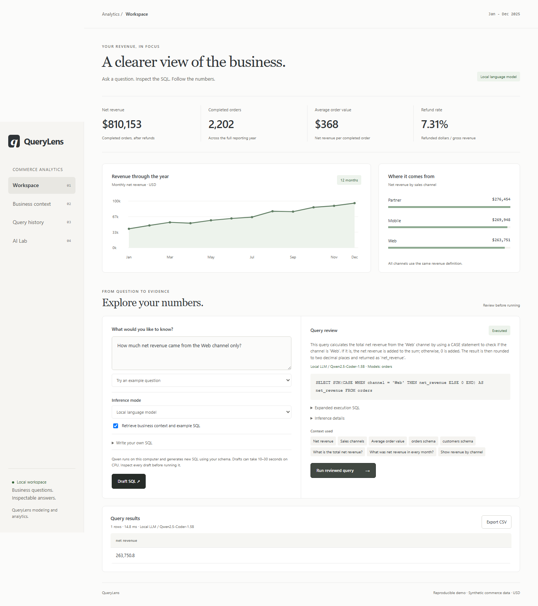
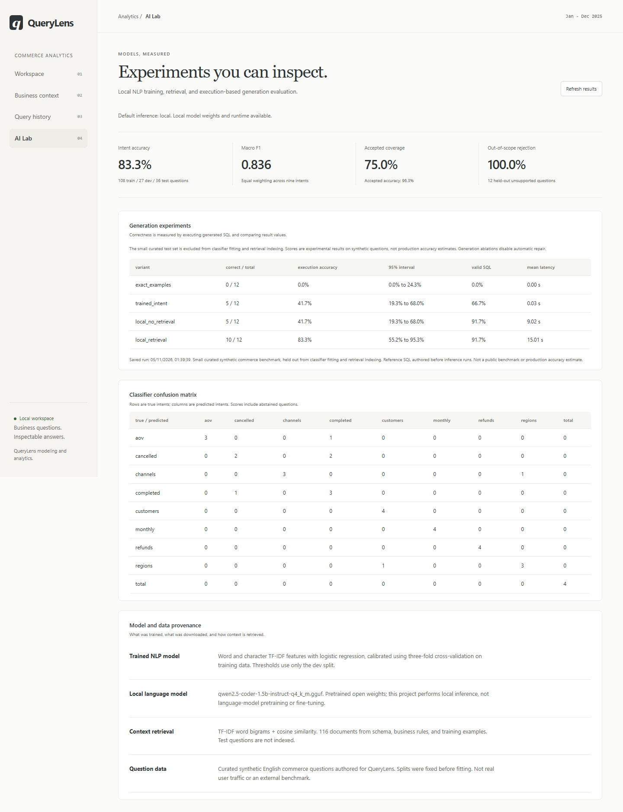

# QueryLens

An independent analytics workbench that turns business questions into reviewable
SQL, consistent revenue metrics, and inspectable results.

QueryLens combines a declarative business-model registry, a scope-aware SQL
compiler, trained NLP routing, local language-model generation, and a complete
browser workflow. The local version runs inference on your computer without a
hosted model API; the public demo runs the trained classifier on its own server.

**[Try the live demo](https://querylens-deviantecho.onrender.com)**

The hosted demo includes the trained intent classifier, SQL workbench, CSV
exports, and AI Lab. Qwen generation runs in the local version. The first visit
after inactivity may take about a minute to start.

## Documentation

| Guide | Contents |
| --- | --- |
| [Deployment](DEPLOYMENT.md) | Current live URL, Render setup, environment variables, API, limits, and troubleshooting |
| [Model card](MODEL_CARD.md) | Classifier training, pretrained Qwen inference, retrieval, and evaluation boundaries |
| [Measured results](reports/README.md) | Saved scores, latency, sample sizes, failed cases, and model provenance |
| [Validation](VALIDATION.md) | 66-test suite, nine analytical regression cases, CI, and live-demo verification |
| [Changelog](CHANGELOG.md) | Standalone application, local AI, public hosting, and documentation updates |

## Hosted demo and local application

| Capability | Public demo | Local application |
| --- | --- | --- |
| Dashboard, business models, SQL editor, CSV export | Available | Available |
| Trained intent classifier and fixed examples | Available | Available |
| Qwen generation with optional retrieved context | Local installation only | Requires the optional runtime and downloaded weights |
| AI Lab classifier scores | Available | Available |
| Qwen experiment results | Saved local experiment, displayed for inspection | Run the benchmark to produce a current local report |
| Query history | Temporary, scoped to a browser session | Stored in the local SQLite database |

To try the hosted workflow, draft "Compare revenue across regions", inspect its
SQL, select **Run reviewed query**, and export the result. The classifier covers
nine unfiltered report types. Use the SQL editor for filters, for example:

```sql
SELECT ROUND(SUM(net_revenue), 2) AS web_revenue
FROM orders
WHERE channel = 'Web'
```

The seeded dataset returns USD 263,750.80 for this query. Every query still
requires a reviewed plan before execution.

## Quick start

Requires Python 3.11 or later.

```powershell
python -m venv .venv
.\.venv\Scripts\Activate.ps1
python -m pip install -e ".[dev]"
python -m querylens
```

On macOS/Linux, activate with `source .venv/bin/activate` instead. Open
http://127.0.0.1:8766. Alternatively, `uv run python -m querylens` creates an
environment and runs the application. The first run creates local synthetic
data in `.querylens/`; the warehouse and history are excluded from version control.



The screenshot shows the local Qwen workflow. The free hosted demo selects the
trained classifier and disables the Qwen option.

## Features

- Revenue dashboard, monthly trends, channel analysis, and CSV exports.
- Declarative models mapping business names to physical tables.
- Calculated fields with dependency ordering and cycle detection.
- SQL compilation using ASTs and scope resolution, including joins, aliases,
  CTEs, model-shadowing CTE names, and UNION queries.
- A model-definition fingerprint attached to each reviewed plan.
- Business-context retrieval, nine offline example questions, and a SQL editor.
- A supervised intent classifier with calibrated probabilities and abstention.
- CPU-local Qwen text-to-SQL inference through llama.cpp, with structured JSON.
- TF-IDF/cosine retrieval of business definitions and training examples.
- An AI Lab with held-out classifier scores and generation ablation results.
- Draft, validate, review, execute, and audit workflow with stored plans.
- Read-only execution, disabled external data access, query deadlines, memory
  limits, bounded results, and local request protection.
- Independent analytical regression checks and application/API tests.
- Free public hosting with anonymous browser sessions, private session history,
  request limits, and a cached startup dashboard.

## Architecture

```text
Browser question
  -> trained classifier: question features -> approved SQL template
  OR local Qwen: schema + optional retrieved rules/examples -> generated SQL
  OR fixed example lookup / user-written SQL
  -> read-only SQL AST validation
  -> QueryLens model compiler
       resolve model tables in SQL scopes
       order calculated fields by dependency
       generate typed model projections as CTEs
       preserve aliases and existing user CTEs
       attach model fingerprint
  -> DuckDB EXPLAIN validation
  -> at most one validation-error repair for local generation
  -> stored plan / human review
  -> read-only DuckDB execution
  -> results, CSV export, execution history

Hosted boundary
  -> explicit public hostname + HTTPS proxy
  -> anonymous cookie + per-session request token
  -> session-owned reviewed plans and history
  -> rate limits + one planning/execution operation at a time
```

The application-specific compiler and model registry are implemented in this
repository. sqlglot supplies SQL parsing and AST primitives; DuckDB supplies the
database engine. Python's standard library provides the HTTP server and SQLite
history storage. The browser client uses JavaScript and CSS without a frontend
framework.

`querylens.hosted` starts the public mode; `querylens.demo` owns its bounded
session state. Public bootstrap requests reuse a dashboard computed at startup.
Retrieved context supports review in classifier/example modes; classifier
predictions depend on question text, not on the retrieved documents.

## Business models

The model definitions live in `querylens/models.json`. For example:

```json
{
  "net_revenue": {
    "type": "DOUBLE",
    "expression": "CASE WHEN status = 'completed' THEN gross_amount - refund_amount ELSE 0.0 END"
  }
}
```

Calculated fields may reference other fields of the same model. The registry
checks those references, rejects cycles, and computes a valid evaluation order.
Its compiler creates nested projections for calculated dependencies and inserts
the required model CTEs before the user's existing CTEs. Identifying tables by
scope avoids rewriting a user CTE that happens to have the same name as a model.

This is a small application-specific modeling layer, not a universal SQL planner.
DuckDB remains responsible for database binding, optimization, and execution.

## Dataset and metrics

The demo creates 2,376 synthetic orders and 48 synthetic customers covering 2025,
using seed 42. All money is USD; there is no real customer information.

| Metric | Definition |
| --- | --- |
| Net revenue | Gross amount minus refund amount for completed orders; zero for cancelled orders |
| Completed orders | Orders with status `completed` |
| Average order value | Net revenue divided by completed-order count |
| Refund rate | Refunded dollars divided by gross dollars for completed orders, multiplied by 100 |

Synthetic monetary values are stored as doubles. The independent regression
oracle uses Python Decimal aggregations and a small numerical tolerance; the
application is not an accounting ledger.

## Local AI setup

The trained intent classifier runs after the basic install. On first launch,
the application fits it from the bundled training split and saves its model,
checksum, and report under `.querylens/ai/`. It recognizes nine unfiltered report
intents; it does not generate arbitrary SQL. Confidence thresholds and scope
checks reject many uncertain or unsupported requests; the model card and saved
evaluation also document incorrect accepted cases.

For language-model generation, install the CPU runtime and download the public
Qwen2.5-Coder-1.5B-Instruct Q4_K_M weights (about 1.12 GB):

```powershell
python -m pip install llama-cpp-python==0.3.36 --extra-index-url https://abetlen.github.io/llama-cpp-python/whl/cpu
python -m querylens.model_download
python -m querylens
```

The downloader resolves an upstream repository revision, downloads from that
revision, and verifies the published SHA-256 checksum and file size. It records
the revision and checksum for a new download. The exact weights used in the
saved experiment are identified by `reports/model-manifest.json`; a later
download can resolve a newer upstream revision. Model weights are local,
ignored by Git, and never included in the project source archive. Internet access is needed for initial setup;
generation itself is offline. There is no API key or per-query fee.

In the local application's default `auto` mode, a configured `QUERYLENS_MODEL`
selects Ollama first; otherwise available GGUF weights/runtime select Qwen,
with the trained classifier as the fallback. The UI allows switching between those modes
and the fixed example library. `QUERYLENS_MODE=local|intent|examples|ollama` can
set an explicit default; `QUERYLENS_GGUF` selects another local GGUF file.

The language model receives schema and retrieved context, produces structured
SQL, and passes through AST/binder validation. A failed draft may receive one
repair attempt using the validation error. Every accepted draft still needs
human review. Inference details record its model, tokens, latency, retrieval
setting, and SQL attempts. No model-generated confidence score is claimed.

An existing local Ollama installation is still supported using `QUERYLENS_MODEL`
with its installed model name; this integration calls only loopback.

See [MODEL_CARD.md](MODEL_CARD.md) for training data, limitations, evaluation
methodology, and the distinction between the trained classifier and pretrained LLM.

## Measured results

| Experiment | Saved result | Scope |
| --- | --- | --- |
| Intent classification | 30/36 correct; macro F1 0.8361 | Nine report intents on curated synthetic test questions |
| Accepted classifier predictions | 26/27 correct at 27/36 coverage | Dev-selected probability and margin thresholds |
| Qwen generation without retrieval | 5/12 execution-correct | CPU-local inference, repair disabled |
| Qwen generation with retrieval | 10/12 execution-correct | Same model and benchmark, repair disabled |

Classification accuracy and SQL execution accuracy measure different tasks.
The retrieval-assisted score has a wide 95% Wilson interval of 55.2%–95.3%.
These are small demonstration experiments, with failures retained in
[the complete reports](reports/README.md), not production accuracy estimates.
Qwen latency measurements describe the recorded local CPU run, not the web host.

## Verification

```sh
python -m pytest
ruff check querylens tests_querylens
ruff format --check querylens tests_querylens
python -m querylens --eval
python -m querylens --train-ml
python -m querylens --ai-eval --skip-llm
python -m querylens --ai-eval
```

The nine analytical regression cases compare actual compiled-query results with
independent Python calculations of raw records, rather than comparing SQL text.
Compiler tests exercise field dependencies, cycles, scope collisions, aliases,
joins, UNIONs, reserved identifiers, and repeatability.

`--train-ml` reports classifier accuracy, macro F1, selective coverage/accuracy,
out-of-scope rejection, per-class scores, and a confusion matrix. The classifier
uses 108 training, 27 development, and 36 test questions, plus separate
development/test unsupported-question sets. The threshold is selected using
development data only.

`--ai-eval` compares exact examples, the trained intent router, local generation
without retrieval, and local generation with retrieval. Twelve held-out
answerable questions are scored by result values against reference SQL; three
additional questions check refusal behavior. Automatic repair is disabled in
this comparison. The report includes generated SQL, errors, execution accuracy,
SQL validity, latency, counts, and 95% Wilson intervals. Small synthetic test
sets do not establish production accuracy.

View saved results in AI Lab. Reproducible reports are also retained under
`reports/` after verification. Full runs save current output to
`.querylens/reports/ai-evaluation.json`. `--eval-limit` is for debugging and the
report discloses the actual case count.



This screenshot records the local experiment view. The public AI Lab also labels
the Qwen scores as saved local experiments rather than live hosted generation.

## Source map

```text
querylens/
  models.json       Declarative business models
  modeling.py       Registry, expression validation, dependency DAG, projections
  planner.py        Scope-aware model expansion and compiler trace
  catalog.py        Business rules and example question library
  dataset.py        Deterministic synthetic warehouse
  policy.py         SQL query boundary
  provider.py       Example and local-model generation adapters
  model_download.py Pinned model download and checksum verification
  ai/               Training, local inference, retrieval, and ablation evaluation
  service.py        Planning, review, execution, history, dashboard
  server.py         Local/public HTTP API, request controls, and static assets
  demo.py           Bounded anonymous sessions, plan ownership, and rate limits
  hosted.py         Free-host entry point, startup reports, and public hostname
  evaluation.py     Independent analytical result checks
  static/           Browser interface, charts, CSV export
tests_querylens/    Compiler, AI, application, local API, and public-demo tests
.github/workflows/ci.yml
render.yaml        Reproducible free Python web-service configuration
MODEL_CARD.md      Model design, methodology, and limitations
reports/           Measured results and pretrained-model provenance
VALIDATION.md      Verification scope and observed behavior
DEPLOYMENT.md      Hosted/local operation, API, limits, and troubleshooting
CHANGELOG.md       Project change history
```

## Deployment scope

The default application is a single-user local demonstration. It binds to
`127.0.0.1` and checks Host headers plus a per-process token for POST requests.

The public demo is deployed at
**[querylens-deviantecho.onrender.com](https://querylens-deviantecho.onrender.com)**.
`render.yaml` provides a configuration for the same application on Render's **free**
Python web-service plan. It runs `python -m querylens.hosted`, binds to the
platform port, and permits only the configured public hostname. The live demo
supports the trained classifier, fixed examples, SQL editor, CSV export, and
AI Lab. Qwen's 1.12 GB weights do not fit the free instance's 512 MB RAM;
LLM generation remains a local feature. AI Lab clearly labels saved local-model
experiments separately from live classifier inference.

Anonymous demo sessions use Secure/HttpOnly/SameSite cookies, separate request
tokens, session-scoped plans/history, one-hour inactivity expiry, bounded
storage, and request/concurrency limits. DuckDB has a 128 MB execution memory
limit in hosted mode. The dataset contains only deterministic synthetic records.
History resets on restarts; this is not an account-based multi-user product.
Render's free service sleeps after 15 idle minutes, so the first visit may take
about a minute to start. Its free usage limits apply.

See [the deployment guide](DEPLOYMENT.md) for the active service configuration,
local-versus-hosted settings, HTTP API, retention limits, and restart behavior.

It currently uses a fixed commerce schema. Hosted authentication, custom-source
ingestion, scheduled ETL, and multi-tenant permissions are not implemented. A
successful query regression suite is not a measurement of LLM accuracy or
production scalability.

## License

Application source is MIT licensed. Runtime dependencies retain their own
licenses: DuckDB, sqlglot, scikit-learn, and llama-cpp-python are third-party
libraries. The Qwen language-model weights are pretrained by their publisher,
under their own Apache-2.0 license; this project does not claim to have trained
or fine-tuned that language model.
